# Conjure

Conjure is an AI video editing agent for real street footage. You type a plain-English command
("remove the person on the left", "replace the yellow taxi with a car", "add a traffic cone in the
middle of the crosswalk") or click an object, and Conjure tracks it across every frame and edits it.
It also searches indexed footage for objects and anonymizes faces and plates in one click. Every edit
is written to a hash-chained, HMAC-signed provenance log.

> **Conjure never silently alters footage. Every output carries a verifiable record of what was changed.**

Live app: open <https://workshop.thecosmoslabs.com> and click the **App** button (team-1, Ingress path `/app`).

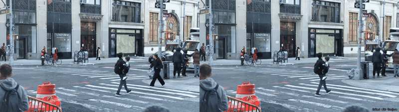

## Preflight checklist (filled in on build day)

```text
[x] Team / namespace:                            team-1
[x] SafeRoute still deployed at /app?            yes at start; replaced by Conjure (SafeRoute Ingress
                                                 removed, deployment scaled to 0, ConfigMap + Secret kept)
[x] Secret saferoute-vss-creds present, keys:    GPU_BEARER_TOKEN, VSS_PASSWORD, VSS_USERNAME,
                                                 WANDB_API_KEY, WANDB_PROJECT, WANDB_TEAM
                                                 (copied into conjure-creds, which adds VSS_URL,
                                                 COSMOS3_REASON_URL, YOLO_URL, CONJURE_SIGNING_KEY)
[x] VSS login + search + stream from a pod:      ok
[x] Cosmos endpoint, model id:                   nvidia/cosmos3-nano-reasoner
[x] YOLO endpoint returns boxes?                 yes (per-frame xyxy boxes, class, confidence; the VSS
                                                 detections sidecar returns the same and is used first)
[x] GPU schedulable in the namespace?            no (every node reports insufficient nvidia.com/gpu)
[x] torch installs on python:3.12-slim?          not used; the pipeline is NumPy + OpenCV on CPU
[x] Weights download from the pod?               not needed (no local model weights)
[x] W&B inference model used:                    meta-llama/Llama-3.3-70B-Instruct (fallback 3.1-8B)
[x] Weave init from the pod:                     ok
[x] git push from the VM works:                  yes over HTTPS (SSH key not authorized)
[x] Conjure URL (path chosen):                   /app, opened via the workshop App button
[x] Final model set:                             detector YOLO11 / segmenter clean-plate difference mask
                                                 inside the YOLO box / tracker IoU tracker with gap
                                                 interpolation / inpainter temporal clean plate
                                                 (Telea fallback); NL parser Llama-3.3-70B;
                                                 reviewer Cosmos3 nano reasoner
```

Because no GPU could be scheduled, SAM2, ProPainter and LaMa were not used. Conjure uses a CPU
pipeline that works well on fixed street cameras (see "How removal works" and "Limits").

## What works

All of these run on the deployed app and are shown in `docs/`.

| # | Feature | What it does |
|---|---------|--------------|
| 1 | **Remove** | Erases a tracked object from every frame it appears in. Carried items (bags, umbrellas) go with the person. People walking beside or in front of the target are protected. |
| 2 | **Track-and-edit** | YOLO11 boxes on every frame are linked into tracks, so one command edits the object for its whole time on screen. |
| 3 | **Natural-language targeting + click select** | Llama-3.3-70B parses the command into strict JSON (action, class, color, position, quantity), which Conjure checks against the detected objects. Ambiguous commands ("remove the car" with 3 cars) return a candidate picker with thumbnails. Clicking an object on the video opens a remove / blur / replace popover. |
| 4 | **Before/after viewer** | A drag slider, side-by-side, or edited-only view, all kept in sync. |
| 5 | **Signed provenance log** | One JSONL entry per edit, ingest, revert, and refusal. Each entry has input/output sha256 hashes, the previous entry's hash, and an HMAC-SHA256 signature with a key from a Kubernetes Secret. The UI verifies the chain and the artifact hashes. |
| 6 | **Replace** | Removes the target, then composites a sprite that follows its track at the right scale and direction: a real car or person cut out of the archive footage, or a procedural cone / barrier / bollard. |
| 7 | **Add** | Places a sprite at a clicked point or a described position, with perspective scale, a contact shadow, occlusion by people who walk in front, and light matching. |
| 8 | **Object search** | Searches VSS-indexed footage with an optional class filter and shows thumbnails. One click loads a result as an editable clip. |
| 9 | **Anonymize** | One-click blur of every person's head and every vehicle's plate zone. |
| 10 | **Edit history / undo** | Every version is kept. You can revert to any version (logged in provenance) or compare any two. |

Also included: a guardrail that refuses deceptive commands such as "remove the car so the insurance
can't prove it was there". The refusal returns HTTP 403 and is logged in provenance. Every export
has a default-on "Edited with Conjure" watermark. A blind Cosmos3 quality review scores each output
against a baseline score of the unedited clip. A model-calls panel shows Weave-traced stats.

## Evidence

Before/after frame pairs (left original, right Conjure output; each row is a different moment):

| Edit | Command | Image |
|------|---------|-------|
| Remove | click the woman crossing, then Remove | [docs/before_after/remove.jpg](docs/before_after/remove.jpg) |
| Replace | "replace the yellow taxi with a car" | [docs/before_after/replace.jpg](docs/before_after/replace.jpg) |
| Add | "add a traffic cone in the middle of the crosswalk" | [docs/before_after/add.jpg](docs/before_after/add.jpg) |
| Blur | click a person, then Blur | [docs/before_after/blur.jpg](docs/before_after/blur.jpg) |
| Anonymize | one click | [docs/before_after/anonymize.jpg](docs/before_after/anonymize.jpg) |

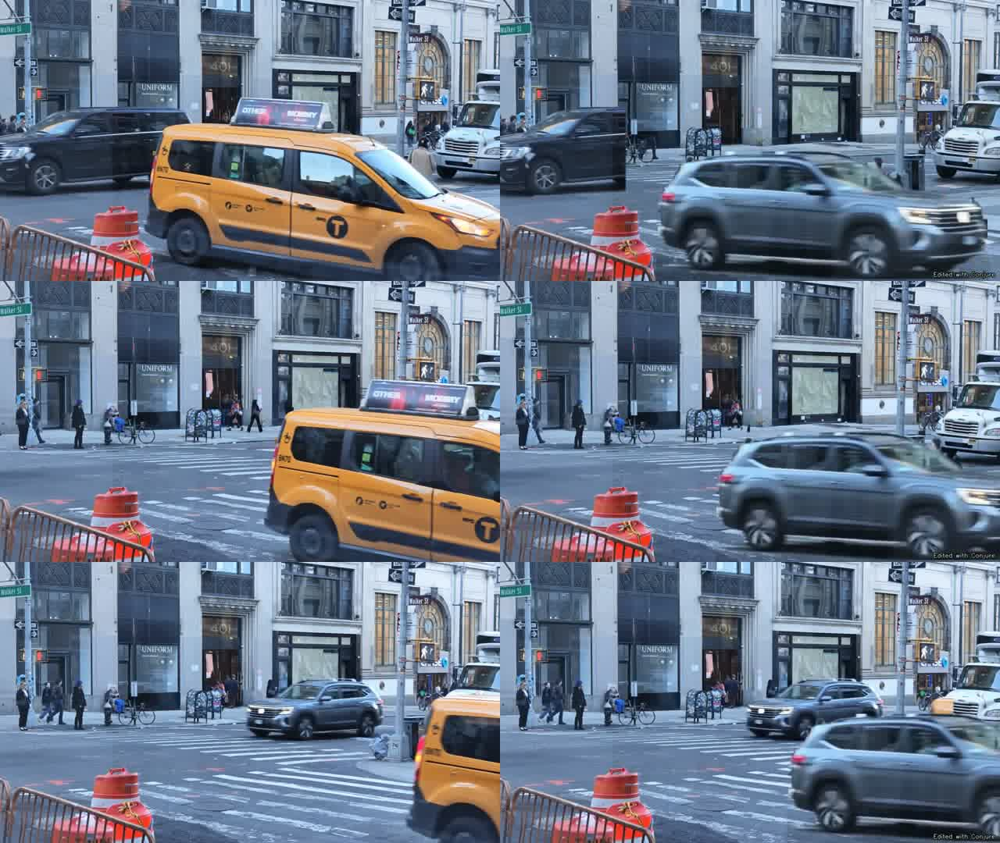

UI screenshots, captured from the deployed app with headless Chrome (`scripts/capture_screens.mjs`):

| | |
|---|---|
| 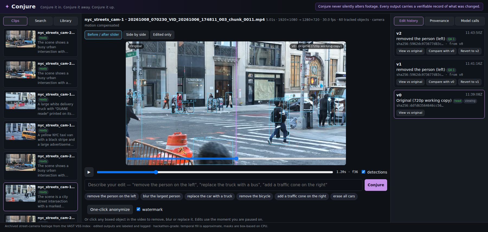 Editor with tracked detections | 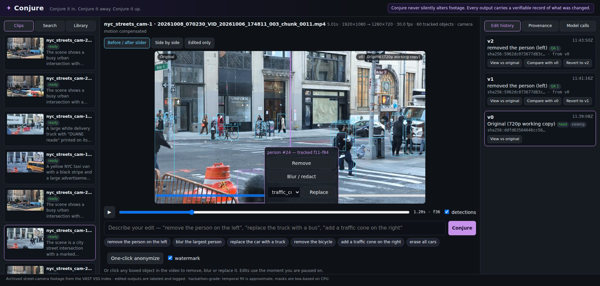 Click to select |
| 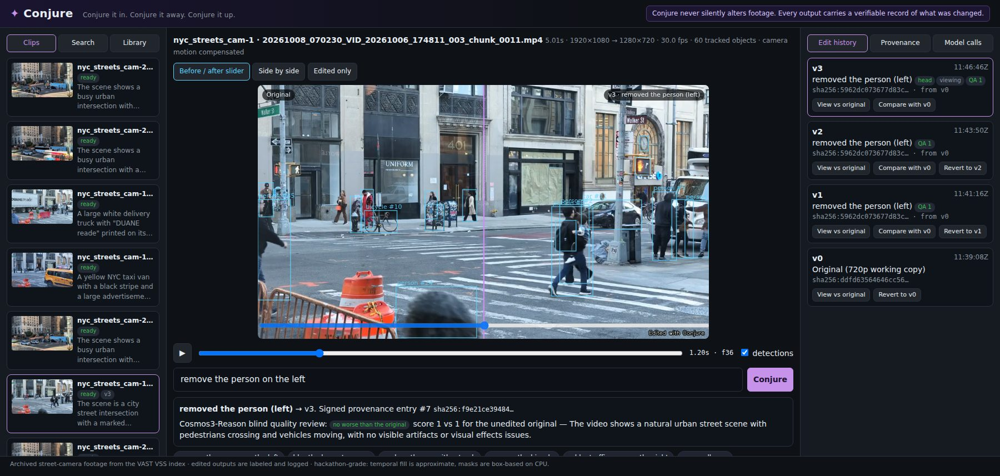 Before/after slider | 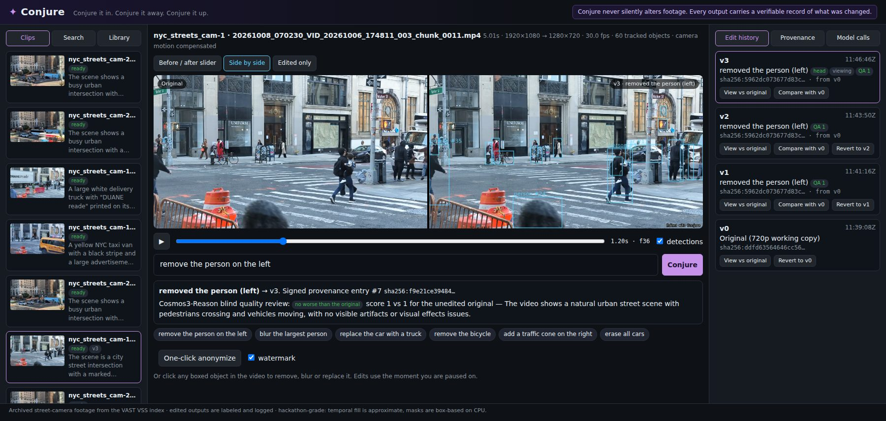 Side by side |
| 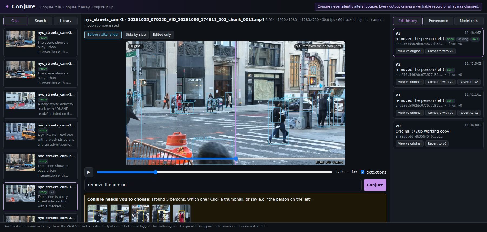 Candidate picker for ambiguous commands |  Guardrail refusal |
| 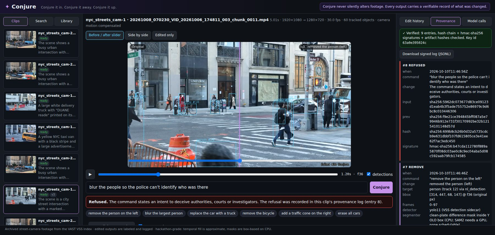 Provenance verified |  Edit history and revert |
| 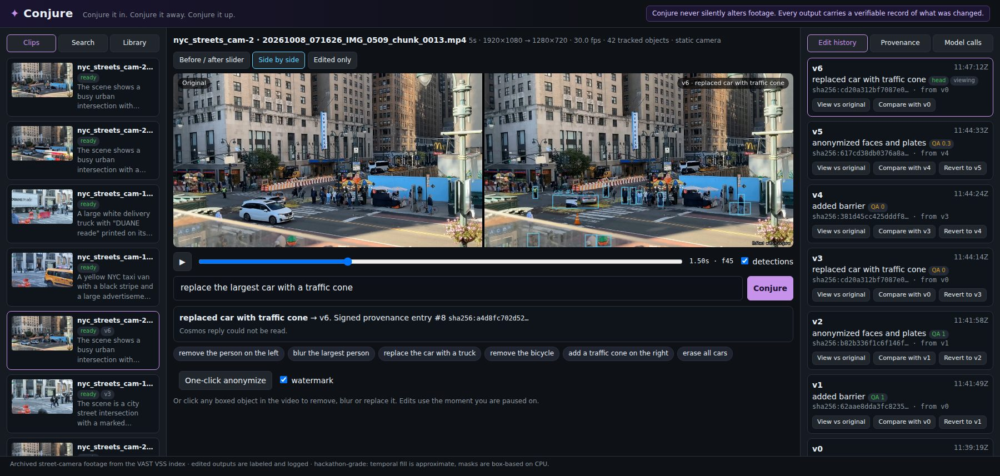 Replace | 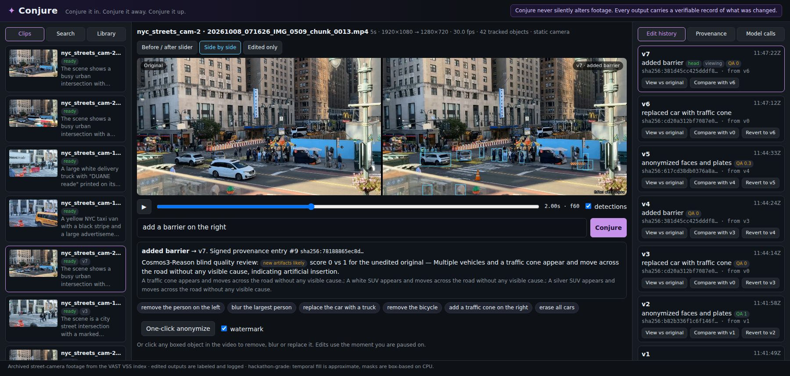 Add a barrier |
| 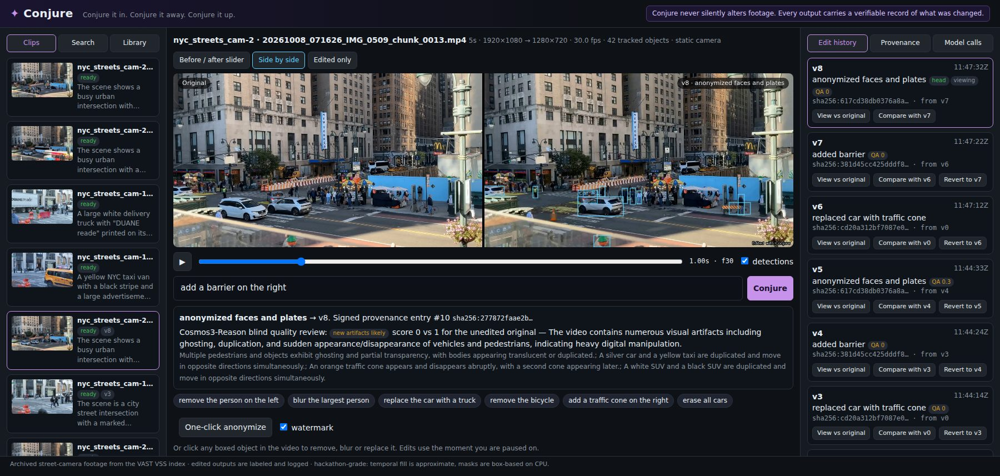 Anonymize | 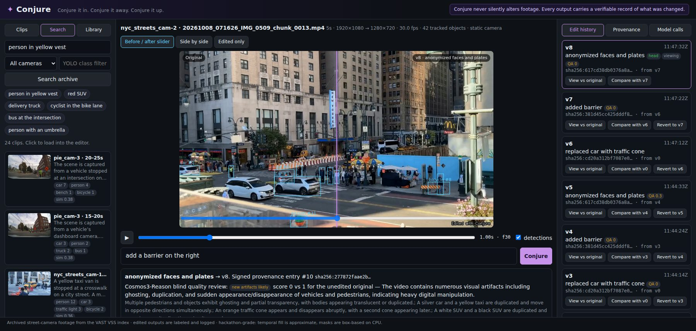 Object search |
| 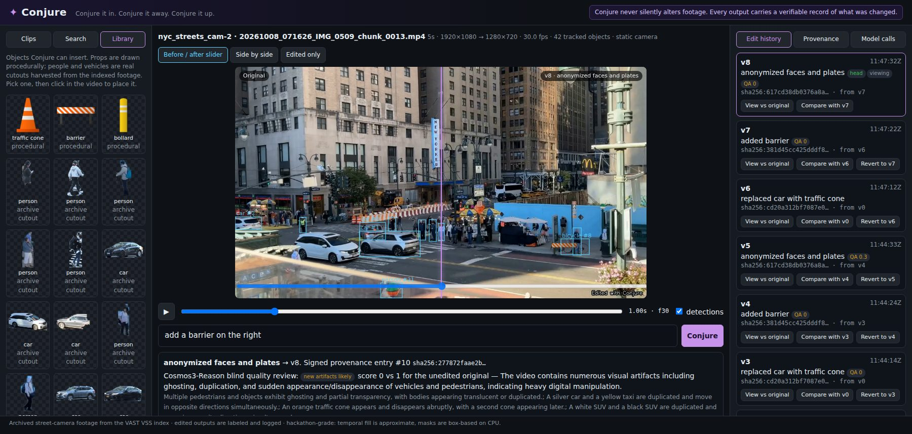 Sprite library |  Model calls |

Full provenance logs: [docs/provenance/49f4006954d9.jsonl](docs/provenance/49f4006954d9.jsonl)
(crosswalk clip, 25 entries) and [docs/provenance/e953d8447526.jsonl](docs/provenance/e953d8447526.jsonl)
(taxi clip). Both verified `ok` against the server key when exported.

## Architecture

```text
 Browser (single page: viewer, slider, click overlay, history, provenance, search)
    |  relative URLs under /app
    v
 Ingress /app  ->  Service conjure  ->  Pod (python:3.12-slim, Flask, one worker thread for jobs)
                                          |  code from ConfigMap conjure-code
                                          |  creds from Secret conjure-creds (server-side only)
                                          |  clips, versions, provenance on PVC conjure-data (/data)
        +---------------------------------+------------------------------+
        |                    |                     |                     |
   VSS (search, stream,  YOLO11 endpoint      W&B Inference         Cosmos3 nano reasoner
   detections sidecar)   (fallback detector)  Llama-3.3-70B         (blind quality review,
                                              (NL -> JSON intent)    captions)
                                              + Weave tracing

 Prepare (once per clip): download -> transcode to 720p v0 -> detect -> track -> align frames
                          -> build temporal clean plate -> harvest sprite cutouts -> provenance "ingest"
 Edit (per command):      guardrail -> parse (LLM, rule fallback) -> resolve target / ask user
                          -> remove | blur | replace | add | anonymize -> watermark -> encode
                          -> Cosmos review -> new version + signed provenance entry
```

### How removal works

The cameras are fixed or nearly fixed, so Conjure builds a **temporal clean plate** for each clip.
For each pixel, the plate is the median over the frames where no moving object covers that pixel.
Small camera shake is handled with ORB + affine registration, and a static camera skips it. To
remove a track, Conjure replaces its pixels in every frame with the plate. The mask is the padded
YOLO box, grown to foreground connected to it (limbs, shadows). The edges are feathered and the
gain is matched to the surrounding pixels. Pixels never seen clean (for example a parked car) fall
back to OpenCV Telea inpainting.

Other objects are protected:
- Objects in front of the target keep all their pixels.
- Objects beside the target keep the pixels nearer their own box center.
- Objects clearly behind the target keep only what lies outside the target's box.

## Provenance

Schema (one JSON object per line in `/data/clips/<id>/provenance.jsonl`, served at
`GET /app/provenance/<clip_id>` and `.jsonl`):

| Field | Meaning |
|-------|---------|
| `edit_id`, `timestamp`, `sequence` | identity and order |
| `operation` | `ingest`, `remove`, `blur`, `replace`, `add`, `anonymize`, `revert`, `refused` |
| `command_text`, `intent` | what the user asked and how it was parsed |
| `target` | `object_class`, `resolution_method` (`nl_detection`, `user_click`, `nl_detection+user_pick`, `one_click_anonymize`), `track_ids`, `anchor_frame`, `bbox` [x, y, w, h] in original-resolution pixels, `frames_affected` |
| `models_used` | detector, tracker, segmenter, editor, NL parser, reviewer |
| `input_artifact`, `output_artifact` | `sha256:` of the input and output video files |
| `input_version`, `output_version` | positions in the clip's version history |
| `parameters`, `qa` | editor details and the Cosmos review (score, baseline, issues) |
| `prev_entry_hash`, `entry_hash` | sha256 chain over canonical JSON |
| `signing_key_id`, `signature` | key fingerprint and `hmac-sha256:` over the entry |

Example entry (from the taxi clip):

```json
{
  "clip_id": "e953d8447526",
  "command_text": "replace the yellow taxi with a car",
  "description": "replaced yellow car with car",
  "edit_id": "35560ef2-75f3-480d-8157-268f55688999",
  "entry_hash": "sha256:a3658f53c52ac4443596e00d2864837de772f5bcffbff3ffced0757a0aaae997",
  "input_artifact": "sha256:7100a9c6aec40f0b2790366dcd68538208f498ed69ca01511bc16c5490ac987d",
  "input_version": 0,
  "intent": {"action": "replace", "attributes": ["yellow"], "new_object": "car", "object_class": "car",
             "position_hint": null, "quantity": "one", "spatial_hint": null},
  "models_used": {
    "detector": "yolo11 (VSS detection sidecar)",
    "editor": "composite following track + temporal-clean-plate",
    "nl_parser": "meta-llama/Llama-3.3-70B-Instruct",
    "reviewer": "nvidia/cosmos3-nano-reasoner",
    "segmenter": "clean-plate difference mask inside YOLO box (CPU; SAM2 needs a GPU, none schedulable)",
    "tracker": "IoU tracker over per-frame YOLO11 boxes, gap interpolation + smoothing"
  },
  "operation": "replace",
  "output_artifact": "sha256:76f4c06fce5991baaaa2153465978f80f9b766b5f738a1c1e55a595ab5a2abf2",
  "output_version": 5,
  "parameters": {"details": [{"editor": "temporal-clean-plate", "telea_pixels": 0, "temporal": true},
                             {"editor": "composite following track", "flipped": true, "sprite": "car_e953d8_36"}],
                 "original_resolution": [1920, 1080], "watermark": true, "working_resolution": [1280, 720]},
  "prev_entry_hash": "sha256:b067d8ad94fe67214972d4de28d5087f7bfac5f5363a24d242fe1f8a95a2cf6a",
  "qa": {"baseline_score": 1.0, "delta": -0.7, "model": "nvidia/cosmos3-nano-reasoner", "natural": false, "score": 0.3},
  "sequence": 8,
  "signature": "hmac-sha256:22bca652c73cccc8b9a280a672ded0d5ad72169b7fcac31ea1b66952f1208f38",
  "signing_key_id": "63a0e395024c",
  "target": {"anchor_frame": 15, "bbox": [676, 423, 1242, 648], "frames_affected": [0, 57],
             "object_class": "car", "resolution_method": "nl_detection", "track_ids": [1]},
  "timestamp": "2026-10-10T11:53:49Z"
}
```

(`qa.issues`/`summary` and the empty carried-item lists are trimmed here; the JSONL file has the full entry.)

## Honesty notes and limits

- **Footage:** only clips already indexed in the workshop VSS archive (fixed street cameras) and
  user uploads. No internet video was ingested.
- **Originals are immutable.** Version 0 is the transcoded original. Every edit writes a new file,
  and reverting only moves the head pointer.
- **CPU only.** No GPU was schedulable, so the segmenter is a clean-plate difference mask, not SAM2,
  and the inpainter is a temporal median plate, not ProPainter or LaMa. This works best on static
  cameras with moving targets. Parked objects fall back to Telea, which looks smeared.
- **Removal artifacts:** where two people overlap, a faint ghost strip can remain. Background
  objects hidden behind a removed object cannot be reconstructed, so they show the plate there.
- **Dense crowds:** in a crosswalk that is never empty, the background is never seen clean. Pixels
  whose few "clean" samples disagree are inpainted, so "remove everyone" leaves a soft gray smudge
  there instead of ghost legs. People YOLO never detects are not removed.
- **Replace and Add use 2D sprites.** They have shadows and scale but no 3D pose. There are no
  truck or bus cutouts in the current library.
- **The Cosmos QA score is noisy.** It is shown next to a baseline score of the unedited clip, as a
  hint rather than a pass/fail judgement.
- **NL targeting** covers class, color, left/right/nearest/largest and quantity. Anything else
  falls back to the candidate picker.
- **Clips are trimmed** to 15 s and processed at 1280x720.

## Built with

| Component | Use |
|-----------|-----|
| VAST VSS (video search, stream, detections) | archive search, clip source, per-frame YOLO11 boxes |
| YOLO11 (hosted endpoint) | fallback per-frame detector |
| W&B Inference: Llama-3.3-70B-Instruct | natural-language command parsing to strict JSON |
| W&B Weave | tracing of every model call |
| NVIDIA Cosmos3 nano reasoner | blind quality review and clip captions |
| OpenCV, NumPy | tracking support, registration, clean plate, compositing, anonymize |
| ffmpeg (imageio-ffmpeg) | decode, encode (H.264, faststart), thumbnails |
| Flask | API and single-page UI |
| Kubernetes (ConfigMap, Secret, PVC, Deployment, Ingress) | deployment on the workshop cluster |

## Quick start (deploy)

```bash
export NS=team-1 KUBECONFIG=/config/team-1-k8s.yaml
# Secret conjure-creds must hold the keys listed in the preflight checklist (never commit values).
kubectl -n "$NS" create configmap conjure-code --from-file=tools/conjure/ --dry-run=client -o yaml | kubectl -n "$NS" apply -f -
sed "s/__APP_HOST__/$APP_HOST/" deploy/conjure.yaml | kubectl -n "$NS" apply -f -
# later code updates: replace the ConfigMap and restart the Python process in place
NS=team-1 ./deploy/update.sh
```

More detail in [tools/conjure/README.md](tools/conjure/README.md).

## License

MIT, see [LICENSE](LICENSE).
